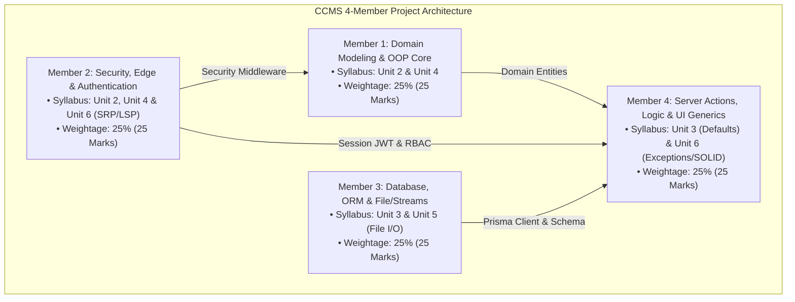

# VIT Clubs (CCMS) — 4-Member Project Distribution & Marking Scheme

> **Course Reference:** Object-Oriented Programming (OOP) — Units 2 through 6  
> **Institution:** Vishwakarma Institute of Technology (VIT Pune)  
> **Project:** Campus Club Management System (CCMS)  
> **Repository:** `https://github.com/codeShul/VIT_clubs`  
> **Live Production:** `https://vit-clubs-code-shul.vercel.app`

---

## 📊 Marking Scheme & Syllabus Alignment Overview

The evaluation rubrics are directly anchored to the **Units 2–6 Course Syllabus**:
- **Unit 2: Classes & Objects** (Class definition, access specifiers, encapsulation, static members, object arrays)
- **Unit 3: Constructors & Destructors** (Parameterized constructors, default arguments, dynamic initialization, destructor cleanup)
- **Unit 4: Inheritance & Polymorphism** (Abstract classes, method overriding, runtime/compile-time polymorphism, interfaces)
- **Unit 5: File Handling & Stream Operations** (File I/O, migration streams, persistent serialization, file modes)
- **Unit 6: Exception Handling, Generic Programming & SOLID** (Try/catch/throw, generics, S.O.L.I.D. principles)

---

## 👥 4-Member Task & Marks Distribution

---

### 👤 Member 1: Domain Architecture & OOP Modeling Lead
**Role:** Chief Domain Architect  
**Marking Weightage:** 25 Marks (25%)  
**Primary Syllabus Units:** **Unit 2** (Classes & Objects) & **Unit 4** (Inheritance & Polymorphism)

#### 1. Syllabus Concepts Covered
- **Abstract Class:** `BaseEntity` cannot be instantiated directly; defines abstract contracts `validate()` and `toJSON()`.
- **Inheritance:** `EventEntity`, `UserEntity`, and `ClubEntity` inherit common identity attributes (`id`, `createdAt`, `updatedAt`) and methods (`isNew()`) from `BaseEntity`.
- **Encapsulation & Access Modifiers:** `UserEntity.password` is marked `private` to prevent leakages; getters and helper methods expose safe state.
- **Runtime Polymorphism:** Overriding `validate()` across entity subclasses (different validation rules for Events vs Users vs Clubs).
- **Static Invariants:** `EventEntity.MAX_CAPACITY = 10000` demonstrates static class constants.
- **UML Class Diagramming:** Designed and maintained the formal Mermaid class diagram.

#### 2. Key Files & Artifacts Owned
- `src/lib/domain.ts` (Pure OOP Domain implementation)
- `diagrams/class-diagram.md` (Mermaid UML Class Diagram)
- `src/lib/mock-data.ts` (Domain models and contracts)

#### 3. Viva & Evaluation Checklist (Marking Scheme)
- [x] Explain the difference between an abstract class and an interface using `BaseEntity` vs `IAuthService`.
- [x] Demonstrate how `validate()` exhibits runtime polymorphism between `EventEntity` and `UserEntity`.
- [x] Show why the private `password` member in `UserEntity` is never serialized in `toJSON()`.

---

### 👤 Member 2: Cybersecurity, Edge & Authentication Lead
**Role:** Security & Infrastructure Lead  
**Marking Weightage:** 25 Marks (25%)  
**Primary Syllabus Units:** **Unit 2** (Encapsulation/Static state), **Unit 4** (Friend Functions / Trusted Callers), **Unit 6** (SOLID Principles & Edge Guards)

#### 1. Syllabus Concepts Covered
- **Encapsulated Static State:** `RateLimiter` class encapsulates a `private static store` (in-memory sliding window bucket) accessed only through `check()` and `cleanup()`.
- **Friend Function Equivalent:** `getServerSession(authOptions)` behaves as a privileged friend function that extracts server-side cryptographic JWT credentials without exposing private keys.
- **Single Responsibility Principle (SRP):** `src/middleware.ts` handles exclusively edge transport security; `src/lib/rate-limit.ts` handles exclusively rate limiting; `src/lib/permissions.ts` handles role checks.
- **Liskov Substitution Principle (LSP):** `CredentialsAuth` implements `IAuthService` such that any auth consumer can interact with the interface without knowing the implementation details.
- **Edge Security Headers:** Injected `HSTS`, `X-Frame-Options: DENY`, `X-Content-Type-Options: nosniff`.

#### 2. Key Files & Artifacts Owned
- `src/middleware.ts` (Edge JWT validation & Role-Based Access Control)
- `src/app/api/auth/[...nextauth]/route.ts` (NextAuth engine, JWT callbacks, bcrypt hashing)
- `src/lib/rate-limit.ts` (Sliding window rate limiter class)
- `src/lib/permissions.ts` (Role guard helper functions)
- `diagrams/deployment-topology.md` (Network security topology)

#### 3. Viva & Evaluation Checklist (Marking Scheme)
- [x] Explain how `RateLimiter` uses static variables and destructor/cleanup patterns.
- [x] Demonstrate how Edge Middleware inspects JWT signatures before requests hit serverless functions.
- [x] Explain how Role-Based Access Control (RBAC) maps `SUPER_ADMIN`, `ADMIN`, and `USER` roles.

---

### 👤 Member 3: Database, ORM & File/Stream Persistence Lead
**Role:** Database & Persistence Engineer  
**Marking Weightage:** 25 Marks (25%)  
**Primary Syllabus Units:** **Unit 3** (Constructors & Dynamic Initialization), **Unit 5** (File Handling & Streams), **Unit 6** (Dependency Inversion Principle)

#### 1. Syllabus Concepts Covered
- **Parameterized Constructors & Dynamic Initialization:** `src/lib/db.ts` dynamically initializes the native connection pool with `{ connectionString }` and instantiates `PrismaClient({ adapter })`.
- **Destructor Pattern / Singleton Lifecycle:** `globalForPrisma` singleton prevents memory leaks and connection pool exhaustion in serverless environments.
- **File Handling & Sequential Streams:** Prisma CLI migrations read and execute sequential `.sql` migration files; `dotenv` opens and streams `.env` files; `updateDates.ts` executes sequential stream queries.
- **Dependency Inversion Principle (DIP):** High-level server actions depend on the abstract Prisma Client interface rather than raw PostgreSQL drivers.
- **Relational Schema Design:** Designed 8 relational entities with foreign-key cascades, compound unique constraints, and enums.

#### 2. Key Files & Artifacts Owned
- `prisma/schema.prisma` (PostgreSQL declarative schema)
- `prisma.config.ts` (Prisma v7 engine configuration)
- `src/lib/db.ts` (Prisma singleton client + PgBouncer adapter)
- `prisma/scripts/updateDates.ts` (Database migration script)
- `diagrams/er-diagram.md` (Entity-Relationship Diagram)

#### 3. Viva & Evaluation Checklist (Marking Scheme)
- [x] Explain why connection pooling (`pgbouncer=true`, port 6543) is required over direct port 5432 in serverless Next.js.
- [x] Walk through the compound unique constraints (`@@unique([userId, eventId])`) in the ER diagram.
- [x] Explain how the singleton constructor pattern in `db.ts` avoids creating multiple database connection pools.

---

### 👤 Member 4: Application Logic, Server Actions & UI Integration Lead
**Role:** Full-Stack Logic & Integration Engineer  
**Marking Weightage:** 25 Marks (25%)  
**Primary Syllabus Units:** **Unit 3** (Default Arguments & Overloading), **Unit 6** (Exception Handling, Generics & Interface Segregation)

#### 1. Syllabus Concepts Covered
- **Exception Handling (Try / Catch / Throw):** Every Server Action wraps operations in robust `try/catch` blocks with custom error messages and fallback states.
- **Generic Programming (Templates / Generics):**
  - React State: `useState<Event[]>([])`, `useState<AuthUser | null>(null)`
  - React Context: `createContext<EventsContextValue | null>(null)`
  - Utility Types: `Partial<Event>`, `Omit<Event, 'id'>`, `Promise<Result<T>>`
- **Constructor Default Arguments & Overloading:** `createEvent()` handles partial input arguments, applying fallback defaults for time, venue, banner images, and capacity.
- **Interface Segregation Principle (ISP):** Clean separation between `EventsContextValue` (for components) and `createEventSchema` (for server actions).
- **IDOR Protection & Transactions:** Server actions verify authenticated user ownership before updates; transactions atomically bundle event status updates with cryptographic permission letter generation.

#### 2. Key Files & Artifacts Owned
- `src/app/actions/events.ts` (Server Actions: CRUD, approvals, registrations, IDOR checks)
- `src/lib/validations.ts` (Zod type-safe validation schemas)
- `src/lib/events-context.tsx` & `src/lib/auth-context.tsx` (Client generic context providers)
- `src/app/portal/admin/events/new/page.tsx` & `/events/[id]/page.tsx` (Portal UI forms & dynamic views)
- `diagrams/sequence-diagram.md` (Request lifecycle diagram)

#### 3. Viva & Evaluation Checklist (Marking Scheme)
- [x] Demonstrate how Zod schemas act as type-safe compile-time and runtime validation guards.
- [x] Show the atomic transaction in `approveEvent` combining `event.update` and `permissionLetter.create`.
- [x] Demonstrate how TypeScript generics are utilized in React Context providers and Server Actions.

---

## 📋 Comprehensive Marking Scheme Rubric (100 Marks Total)

| Member | Evaluation Module | Syllabus Unit | Criteria / Deliverable | Max Marks |
| :--- | :--- | :--- | :--- | :---: |
| **Member 1** | OOP Modeling | Unit 2 & 4 | Inheritance hierarchy, `BaseEntity` abstraction, polymorphism, private encapsulation, UML Class Diagram | **25** |
| **Member 2** | Security & Auth | Unit 2, 4 & 6 | Edge middleware, NextAuth JWT, `RateLimiter` class (static members), RBAC, SOLID (SRP/LSP) | **25** |
| **Member 3** | DB & Persistence | Unit 3 & 5 | Prisma schema ERD, singleton constructor, connection pooler, file/stream migrations, DIP | **25** |
| **Member 4** | Server Actions & Logic | Unit 3 & 6 | Try/catch exception handling, Generics (`Context<T>`, `useState<T>`), Zod validation, IDOR checks, UI integration | **25** |
| **Total** | **Full System** | **Units 2–6** | **Working Production Deployment, Complete Architecture, End-to-End Execution** | **100** |
