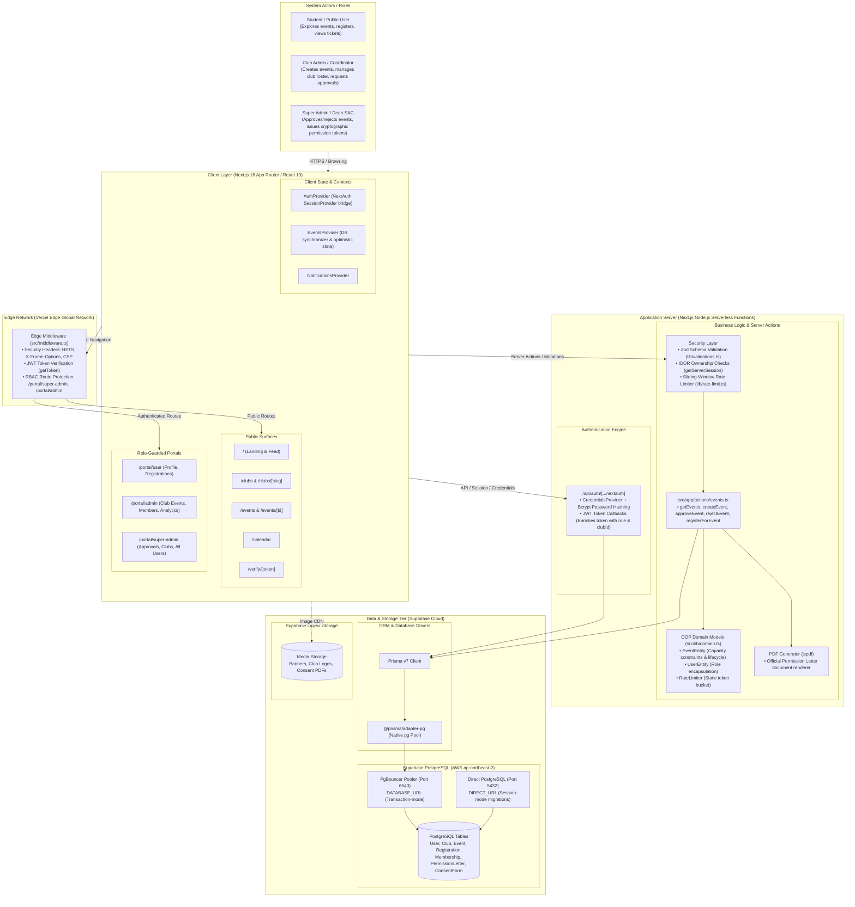
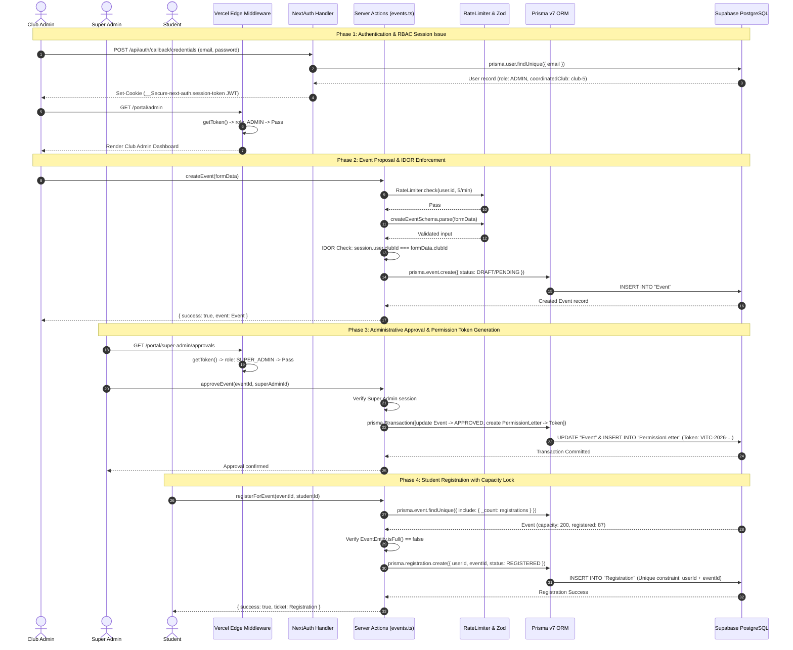
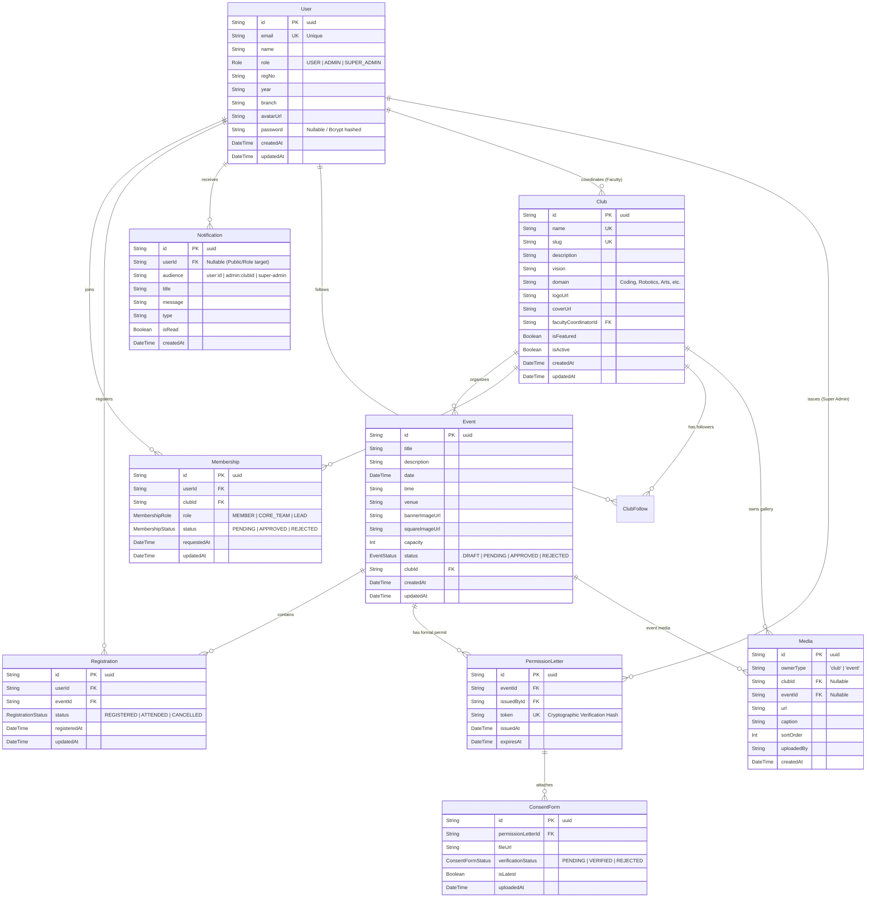
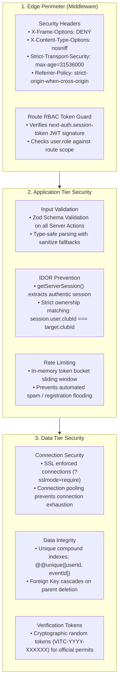

# VIT Clubs (Campus Club Management System - CCMS)
## Comprehensive System Design Document

---

## 1. High-Level Architecture (C4 Container Diagram)



---

## 2. End-to-End Request & Security Flow (Sequence Diagram)

This sequence illustrates the complete lifecycle: Authentication -> Event Proposal -> Super Admin Approval with Cryptographic Token -> Student Registration.



---

## 3. Database Entity-Relationship Diagram (ERD)

The relational data model implemented in `prisma/schema.prisma`:



---

## 4. Network & Deployment Topology

```mermaid
flowchart LR
    subgraph Internet["Public Internet"]
        ClientBrowser["Client Browser<br/>(Desktop / Mobile)"]
    end

    subgraph VercelCloud["Vercel Cloud Infrastructure"]
        VercelEdge["Vercel Anycast Edge Network<br/>• TLS Termination<br/>• DDoS & Edge Cache<br/>• Edge Middleware (Node / V8)"]
        
        ServerlessApp["Serverless Compute (Region: iad1)<br/>• Next.js Server Components<br/>• Next.js Server Actions<br/>• NextAuth API Routes"]
    end

    subgraph SupabaseCloud["Supabase Managed Cloud (AWS ap-northeast-2)"]
        PgBouncerService["PgBouncer Connection Pooler<br/>Port 6543 (Transaction-Mode)<br/>Handles high-concurrency spikes"]
        PostgresInstance["Direct Postgres Engine<br/>Port 5432 (Session-Mode)<br/>DDL & Declarative Migrations"]
        StorageCluster["S3-Compatible Object Store<br/>Static Assets & Image Optimization"]
    end

    ClientBrowser -->|HTTPS :443| VercelEdge
    VercelEdge -->|Internal Routing| ServerlessApp
    ServerlessApp -->|Prisma @prisma/adapter-pg (Port 6543)| PgBouncerService
    ServerlessApp -.->|Migrations (Port 5432)| PostgresInstance
    PgBouncerService -->|Internal IPC / Localhost| PostgresInstance
    ClientBrowser -.->|Direct CDN GET| StorageCluster
```

---

## 5. Security & Defense-in-Depth Architecture


