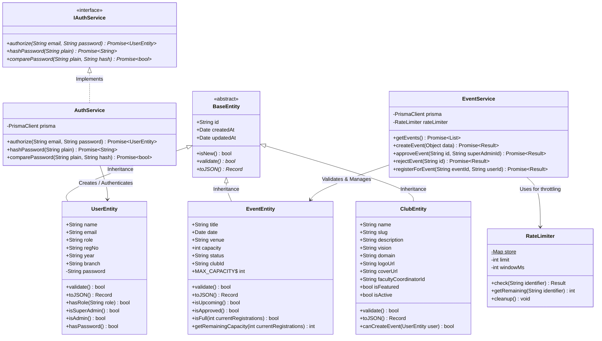

# VIT Clubs — Object-Oriented Class Diagram

This diagram documents the domain class hierarchy, encapsulation boundaries, static members, and interface contracts implemented in `src/lib/domain.ts` and core services.

---

### OOP Pillars & Design Patterns Represented

1. **Abstraction**:
   - `BaseEntity` is an abstract base class requiring subclasses to provide concrete implementations for `validate()` and `toJSON()`.
   - `IAuthService` specifies the interface contract for authentication services.
2. **Inheritance**:
   - `EventEntity`, `UserEntity`, and `ClubEntity` inherit identity fields (`id`, `createdAt`, `updatedAt`) and concrete utility methods (`isNew()`) from `BaseEntity`.
3. **Encapsulation**:
   - `UserEntity.password` is declared `private` and is omitted from `toJSON()` serialization.
   - `RateLimiter.store` is a private, in-memory state map accessible only via guarded `check()` and `cleanup()` methods.
4. **Polymorphism**:
   - `EventEntity.validate()` validates positive capacity boundaries and future dates.
   - `UserEntity.validate()` enforces university email domain constraints (`@vitpune.edu.in`).
5. **Static Members & Singleton State**:
   - `EventEntity.MAX_CAPACITY = 10000` defines a static class-level invariant.
   - `RateLimiter.store` acts as a static shared token bucket across server instances.
