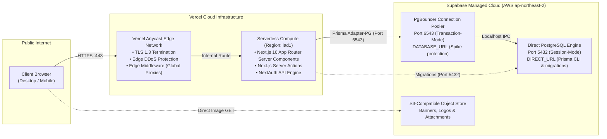

# VIT Clubs — Network & Deployment Topology

This diagram details the cloud infrastructure topology, edge networking, connection pooling, and multi-region deployment setup across Vercel and Supabase.

