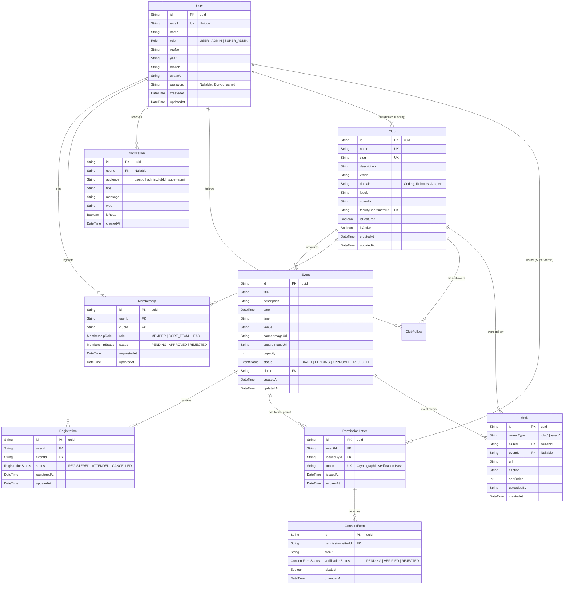

# VIT Clubs — Database Entity-Relationship Diagram (ERD)

This diagram captures the complete PostgreSQL schema implemented in `prisma/schema.prisma`, including relations, foreign keys, compound constraints, and enums.

