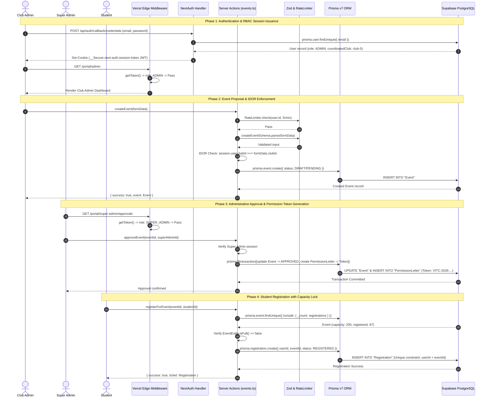

# VIT Clubs — Request & Security Sequence Diagram

This sequence traces the end-to-end execution flow across the system tiers: NextAuth credentials login -> Role guard check -> Event creation with rate-limiting & IDOR check -> Super admin approval with cryptographic permit generation -> Student event registration with concurrency capacity guard.

