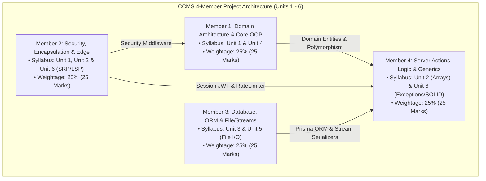

# VIT Clubs (CCMS) — 4-Member Project Distribution & Marking Scheme

> **Course Reference:** Object-Oriented Programming (OOP) — Units 1 through 6  
> **Institution:** Vishwakarma Institute of Technology (VIT Pune)  
> **Project:** Campus Club Management System (CCMS)  
> **Repository:** `https://github.com/codeShul/VIT_clubs`  
> **Live Production:** `https://vit-clubs-code-shul.vercel.app`

---

## 📊 Marking Scheme & Syllabus Alignment Overview (Units 1 – 6)

The evaluation rubrics are directly anchored to the **Units 1–6 Course Syllabus**:
- **Unit 1: Introduction to OOP** (Programming paradigms: Imperative vs. Declarative, procedural limitations, need for OOP, data encapsulation, data abstraction & information hiding, static and dynamic binding, message passing)
- **Unit 2: Classes and Objects** (Creating a class, visibility/access modifiers, encapsulation, methods, 'this' keyword, method overloading, object creation with 'new', object as parameter, returning object, array of objects, static members, static methods)
- **Unit 3: Constructors and Destructors** (Use of constructors, types of constructors, constructor overloading, dynamic initialization of an object, constructors with default arguments, destructors / memory cleanup pattern)
- **Unit 4: Inheritance and Polymorphism** (Types of inheritance, hierarchical inheritance, constructors in derived classes, method overriding, abstract classes and interfaces, compile-time and runtime polymorphism, software reuse, friend functions/privileged callers)
- **Unit 5: File Handling** (Classes for file stream operations, opening and closing files, file modes and combinations, file pointers and manipulators, sequential I/O streams, error handling during file operations)
- **Unit 6: Exception Handling, Generic Programming and S.O.L.I.D.** (Exception types, try/catch/throw, multiple catch clauses, generics, S.O.L.I.D. principles: SRP, OCP, LSP, ISP, DIP)

---

## 👥 4-Member Task & Marks Distribution

---

### 👤 Member 1: Domain Architecture & Core OOP Modeling Lead
**Role:** Chief Domain Architect  
**Marking Weightage:** 25 Marks (25%)  
**Primary Syllabus Units:** **Unit 1** (Introduction to OOP & Fundamentals) & **Unit 4** (Inheritance & Polymorphism)

#### 1. Syllabus Concepts Covered
- **Unit 1 — Paradigms & Rationale:** Documents the limitations of procedural state handling and establishes why the OOP paradigm guarantees data consistency across campus clubs.
- **Unit 1 & 4 — Data Abstraction & Information Hiding:** `abstract class BaseEntity` hides internal mechanics and enforces pure abstract contracts (`validate()`, `toJSON()`).
- **Unit 1 — Message Passing:** Implements `IDomainMessage` and `receiveMessage()` on `BaseEntity` and `EventEntity` for decoupled inter-object state communication.
- **Unit 1 & 4 — Static vs. Dynamic Binding:** Demonstrates compile-time static binding (`EventEntity.MAX_CAPACITY`, `createDraft()`) versus late dynamic binding (`basePointer.validate()`).
- **Unit 4 — Hierarchical Inheritance:** `EventEntity`, `UserEntity`, `ClubEntity`, `RegistrationEntity`, and `PermissionLetterEntity` all inherit from `BaseEntity`.
- **Unit 4 — Method Overriding:** Unique validation rules overridden in `EventEntity.validate()` vs `UserEntity.validate()`.

#### 2. Key Files Owned
- `src/lib/domain.ts` (Core OOP Domain Engine)
- `docs/diagrams/class-diagram.md` (UML Class Diagram)
- `docs/diagrams/system-architecture.md` (System Architecture)

---

### 👤 Member 2: Cybersecurity, Encapsulation & Edge Authentication Lead
**Role:** Security & Infrastructure Lead  
**Marking Weightage:** 25 Marks (25%)  
**Primary Syllabus Units:** **Unit 1** (Data Encapsulation), **Unit 2** (Classes, Objects, Access Modifiers, Static Members), **Unit 6** (S.O.L.I.D. Principles)

#### 1. Syllabus Concepts Covered
- **Unit 1 & 2 — Data Encapsulation:** `UserEntity.password` is strictly marked `private` to shield authentication credentials from unauthorized exposure.
- **Unit 2 — Static Class Members:** `RateLimiter.store` maintains private, shared global state across all requests.
- **Unit 4 — Friend Function Equivalent:** `verifyRawPassword(plain, compareFn)` allows trusted callers (bcrypt/NextAuth) to verify credentials without leaking the private hash.
- **Unit 6 — Single Responsibility Principle (SRP):** `src/middleware.ts` handles edge token verification; `src/lib/rate-limit.ts` handles request throttling; `src/lib/permissions.ts` handles role guards.
- **Unit 6 — Interface Segregation Principle (ISP):** `IAuthService` specifies decoupled authentication methods.

#### 2. Key Files Owned
- `src/middleware.ts` (Edge JWT validation & RBAC)
- `src/app/api/auth/[...nextauth]/route.ts` (NextAuth engine with `UserEntity`)
- `src/lib/rate-limit.ts` (RateLimiter integration)
- `src/lib/permissions.ts` (Role-based access guards)

---

### 👤 Member 3: Database, ORM & File/Stream Persistence Lead
**Role:** Database & Persistence Engineer  
**Marking Weightage:** 25 Marks (25%)  
**Primary Syllabus Units:** **Unit 3** (Constructors & Destructors) & **Unit 5** (File Handling & Streams)

#### 1. Syllabus Concepts Covered
- **Unit 3 — Parameterized Constructors with Default Arguments:** `BaseEntity(id, createdAt ?? new Date(), updatedAt ?? new Date())`.
- **Unit 3 — Constructor Chaining:** Subclasses use `super(...)` to initialize base properties.
- **Unit 3 — Destructor Pattern / Memory Recovery:** `RateLimiter.cleanup()` purges expired timestamp entries to simulate memory recovery (`delete`).
- **Unit 3 — Dynamic Object Initialization:** Runtime connection pool binding in `src/lib/db.ts`.
- **Unit 5 — File Handling & Stream Operations:** `FileStreamManager` with file modes (`READ`, `WRITE`, `APPEND`), file pointer manipulation (`seek()`, `getPointer()`), and sequential line reading.
- **Unit 5 — Stream Serialization:** `StreamSerializer.toCSV()`, `StreamSerializer.fromCSV()`, and `StreamSerializer.toJSONStream()`.

#### 2. Key Files Owned
- `src/lib/db.ts` (Prisma singleton connection pool)
- `prisma/schema.prisma` (PostgreSQL relational schema)
- `src/lib/domain.ts` (`FileStreamManager` & `StreamSerializer`)
- `docs/diagrams/er-diagram.md` & `docs/diagrams/deployment-topology.md`

---

### 👤 Member 4: Server Actions, Business Logic & UI Generics Lead
**Role:** Business Logic & Full-Stack Integration Lead  
**Marking Weightage:** 25 Marks (25%)  
**Primary Syllabus Units:** **Unit 2** (Array of Objects, Methods), **Unit 6** (Exception Handling, Generics & SOLID)

#### 1. Syllabus Concepts Covered
- **Unit 2 — Array of Objects & Generics (Unit 6):** `EntityCollection<T extends BaseEntity>` encapsulates arrays of objects with filter, sort, and batch polymorphic validation (`validateAll()`).
- **Unit 6 — Custom Exception Hierarchy:** `DomainException` -> `ValidationException`, `CapacityExceededException`, `UnauthorizedException`, `NotFoundException`, `DuplicateRegistrationException`.
- **Unit 6 — Exception Handling Mechanism:** Server actions wrap domain mutations in structured `try/catch` blocks, using `safeExecute<T>()` with multiple catch simulations.
- **Unit 6 — Liskov Substitution Principle (LSP):** Subclasses (`EventEntity`, `ClubEntity`) seamlessly satisfy polymorphic calls anywhere `BaseEntity` is accepted.
- **Unit 2 — Method Overloading Simulation:** `EventEntity.updateDetails(...)` accepts polymorphic arguments.

#### 2. Key Files Owned
- `src/app/actions/events.ts` (Domain action validations & exception traps)
- `src/app/actions/clubs.ts` (Club queries with `EntityCollection<ClubEntity>`)
- `src/app/events/[id]/page.tsx` (Live OOP Domain Model analytics panel)
- `src/app/events/page.tsx` (Polymorphic event filtering using `EntityCollection<EventEntity>`)
- `src/app/portal/admin/page.tsx` (Club dashboard OOP analytics)
