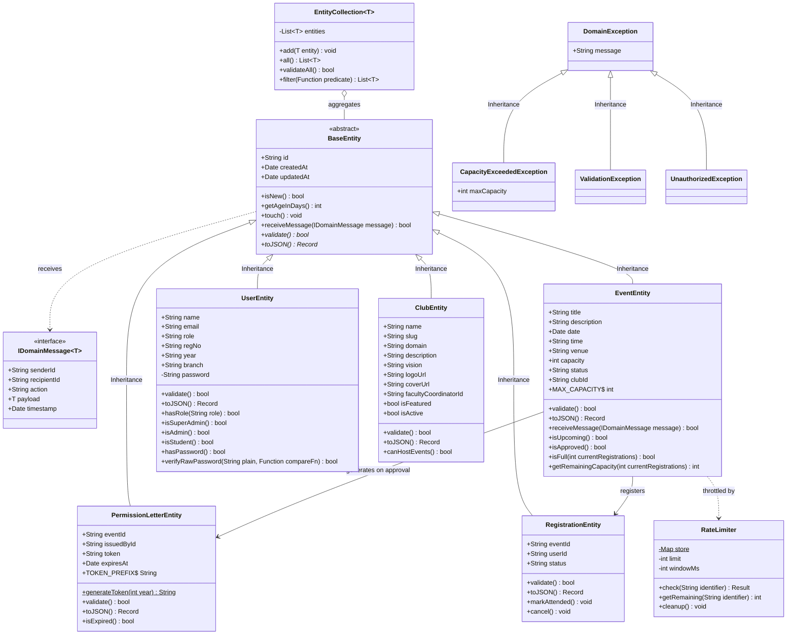

# VIT Clubs — Object-Oriented Class Diagram

This diagram documents the domain class hierarchy, encapsulation boundaries, static members, message passing interface, and collection managers implemented in `src/lib/domain.ts` and core services.

---

### OOP Pillars & Design Patterns Represented

1. **Abstraction**:
   - `BaseEntity` is an abstract base class requiring all subclasses to provide concrete implementations for `validate()` and `toJSON()`.
   - `IDomainMessage<T>` specifies the interface contract for message passing between objects.
2. **Inheritance & Polymorphism**:
   - Subclasses (`EventEntity`, `UserEntity`, `ClubEntity`, `RegistrationEntity`, `PermissionLetterEntity`) extend `BaseEntity`, inheriting identity lifecycle methods (`isNew()`, `getAgeInDays()`, `touch()`).
   - Each subclass overrides `validate()` and `toJSON()` with entity-specific constraints.
   - Domain exception hierarchy inherits from `DomainException` (`CapacityExceededException`, `ValidationException`, `UnauthorizedException`).
3. **Encapsulation & Information Hiding**:
   - `UserEntity.password` is declared `private` and is safely omitted from `toJSON()` serialization.
   - `RateLimiter.store` is a private, in-memory state map accessible only via guarded `check()` and `cleanup()` methods.
4. **Message Passing & Event Handling**:
   - `IDomainMessage<T>` and `receiveMessage()` decouple state transitions (such as status updates upon admin approval/rejection).
5. **Generics & Collection Management**:
   - `EntityCollection<T extends BaseEntity>` provides type-safe aggregate operations (`validateAll()`, `filter()`).
